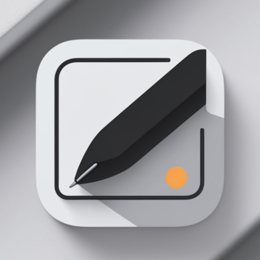
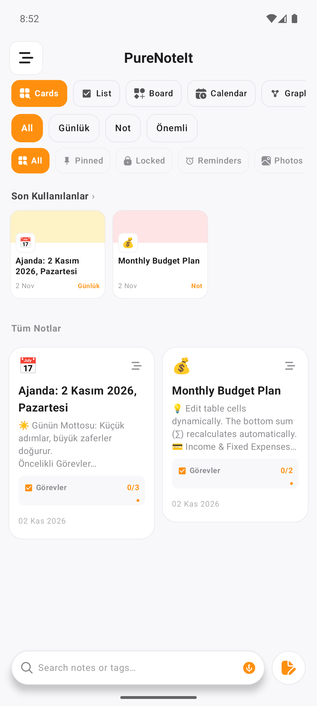
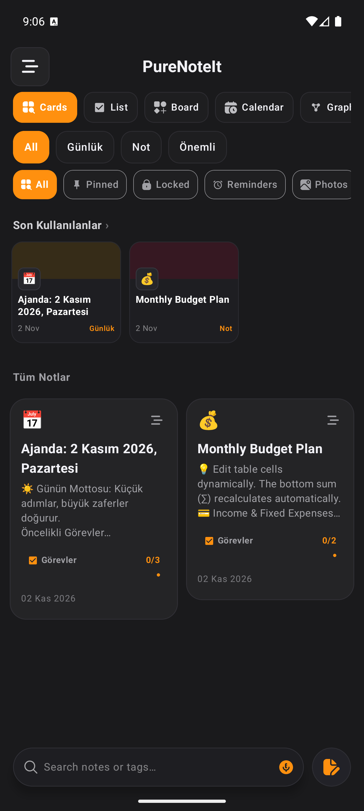
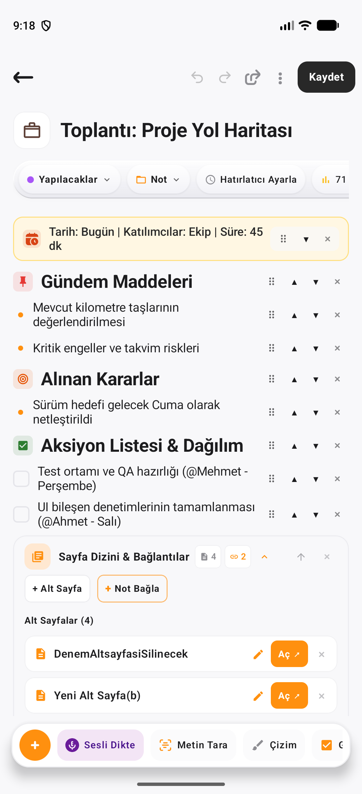
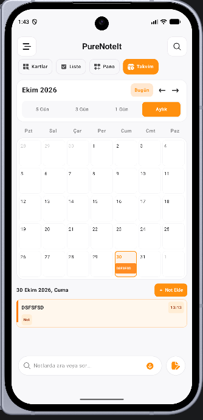
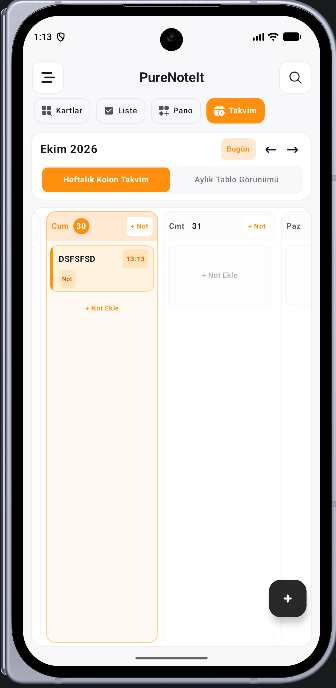
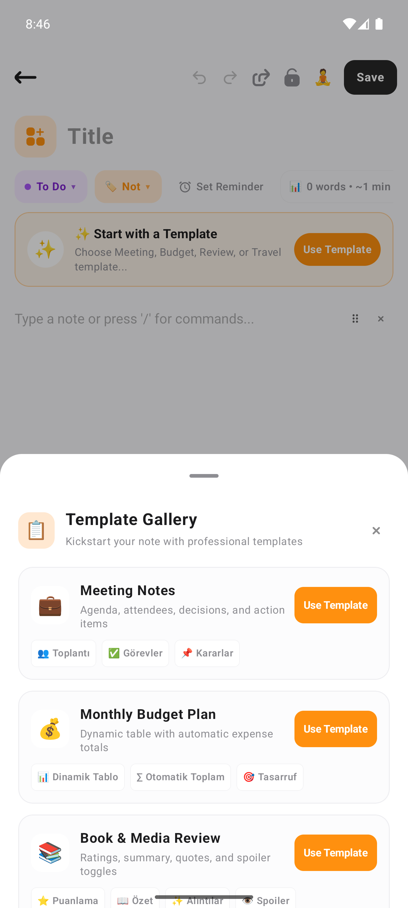
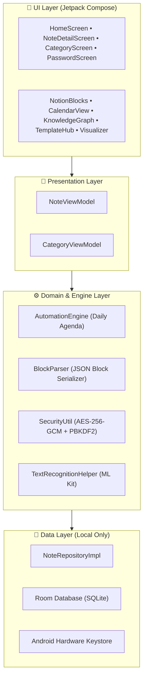

<div align="center">

  

  # PureNoteIt
  ### *Düşüncelerinizin En Saf Hali • The Purest Form of Your Thoughts*

  <p align="center">
    <b>Modern, Blok Tabanlı, Çevrimdışı ve Güvenlik Odaklı Android Kişisel Bilgi İşletim Sistemi (Knowledge OS)</b><br />
    <i>A modern, block-based, offline-first & Bitwarden-grade secure Android personal knowledge system.</i>
  </p>

  <p align="center">
    <a href="#-özellikler--key-features">Özellikler</a> •
    <a href="#-ekran-görüntüleri--screenshots">Ekran Görüntüleri</a> •
    <a href="#-teknoloji-yığını--tech-stack">Teknoloji</a> •
    <a href="#-sürüm-notları--changelog">Sürüm Notları</a> •
    <a href="#-kurulum--building">Kurulum</a> •
    <a href="PRIVACY_POLICY.md">Gizlilik Politikası</a> •
    <a href="LICENSE">Lisans</a>
  </p>

  <p align="center">
    
    
    
    
    
    
    
    
    
  </p>

</div>

---

## 📖 Genel Bakış / Overview

**PureNoteIt**, Notion'ın dinamik blok modülerliğini, Obsidian'ın çift yönlü bağlantı ve bilgi grafiğini (`[[Bağlantı]]`), Bitwarden'ın askeri standarttaki **AES-256-GCM** yerel şifrelemesini tek bir yerel (native) Android uygulamasında birleştiren yeni nesil bir not alma ve düşünce mimarisidir.

Buluta bağımlı olmayan **%100 Çevrimdışı (Offline-First)** mimarisi sayesinde verileriniz yalnızca sizin cihazınızda yaşar. Hiçbir sunucuya veri aktarılmaz, hiçbir kullanıcı takip edilmez, reklam içermez.

---

## 📱 Ekran Görüntüleri / Screenshots

<div align="center">
  <table>
    <tr>
      <td align="center" width="33%">
        <b>Aydınlık Tema Ana Ekran</b><br />
        <sub>Akıllı Filtreler, Kategoriler & Kartlar</sub><br /><br />
        
      </td>
      <td align="center" width="33%">
        <b>Koyu Tema (OLED Black)</b><br />
        <sub>Staggered Grid & Checklist İlerlemesi</sub><br /><br />
        
      </td>
      <td align="center" width="33%">
        <b>Notion Blokları & Tablo</b><br />
        <sub>Dinamik Tablo, Formül & Callout</sub><br /><br />
        
      </td>
    </tr>
    <tr>
      <td align="center" width="33%">
        <b>Aylık İnteraktif Takvim</b><br />
        <sub>Renkli Etkinlik Noktaları (Event Dots)</sub><br /><br />
        
      </td>
      <td align="center" width="33%">
        <b>Haftalık Kolon Ajandası</b><br />
        <sub>Günlük Kolonlar & Zaman Planı</sub><br /><br />
        
      </td>
      <td align="center" width="33%">
        <b>Şablon Galerisi (Templates Hub)</b><br />
        <sub>5 Profesyonel Notion Şablonu</sub><br /><br />
        
      </td>
    </tr>
  </table>
</div>

---

## ✨ Öne Çıkan Özellikler / Key Features

### 🧱 1. Notion Tarzı Dinamik Blok Editörü
- **Zengin Blok Çeşitleri:** Paragraf, Başlık 1 (H1), Başlık 2 (H2), Yapılacaklar (Checklist), Madde İşaretli Liste, Callout (Önemli Kutu), Açılır Kapanır **Toggle** (Spoiler gizleme), Dinamik **Tablolar** (otomatik dip toplam), Serbest El Çizim Kanvası, Fotoğraf ve Ses Dosyaları.
- **💻 Kod Bloğu (Syntax Highlighting) & Monospace:** Kotlin, Python, JavaScript, Java, C++, SQL, HTML, JSON, Bash dillerinde gerçek zamanlı sözdizimi renklendirmesi, macOS tarzı pencere tasarımı, satır numaraları ve tek dokunuşla panoya kopyalama.
- **📐 LaTeX Matematik Bloğu (Math Formula Renderer):** Yunan harfleri (`\alpha`, `\pi`, `\theta`, vb.), kesirler (`\frac{a}{b}`), integraller (`\int`), toplam sembolleri (`\sum`) ve kökler için canlı matematiksel tipografi ve 19 sembollük hızlı matematik çipi paleti.
- **📑 İçindekiler Tablosu (Table of Contents - TOC):** Not içerisindeki tüm H1 ve H2 başlıklarını anlık listeleyen, tıklanan başlığa yumuşak animasyonla kaydıran Notion tarzı içindekiler bloğu ve üst bar hızlı atlama çipi.
- **Hiyerarşik Alt Sayfalar (`Sub-pages`):** Notion tarzı alt sayfalar ana ekranda karmaşayı önlemek için gizlenir, doğrudan bağlı olduğu sayfadan veya global aramayla açılır.
- **Slash Menüsü (`/`):** İstediğiniz bloğu klavyeden tek tuşla ekleyin.

### 🔍 2. Not İçi Derin Arama (Deep Content Search & Snippet Highlighting)
- **Kapsamlı İçerik Taraması:** Başlığı hatırlanmayan notlar dahi içerisindeki tüm bloklardan (paragraf, tablo hücreleri, toggle gövdesi, kod blokları) taranarak milisaniyeler içinde bulunur.
- **Pasaj & Kelime Vurgulama:** Arama terimi not başlığında ve not kartının üzerinde dikkat çekici sarı/turuncu rozetle (`🔍 İçerikte bulundu: ...[kelime]...`) canlı olarak vurgulanır.

### 🔐 3. Bitwarden Seviyesinde Güvenlik & Kasa
- **Donanım Destekli AES-256-GCM Şifreleme:** Kilitli notlar cihazınızın yerel Keystore'u ile şifrelenir.
- **Biyometrik Kilit & PIN Doğrulama:** Parmak izi veya yüz tanıma ile anında güvenli erişim.
- **Arka Plana Geçince Otomatik Kilit (Vault Timeout):** Uygulamadan çıkıldığında veya başka bir uygulamaya geçildiğinde güvenlik oturumu sıfırlanır.
- **Yedekleme & Geri Yükleme:** Şifreli ve güvenli yerel JSON yedek dışa/içe aktarma merkezi.

### 📋 3. Şablon Galerisi (Templates Hub)
- Tek tıkla yüklenen 5 profesyonel hazır Notion şablonu:
  - 🤝 **Toplantı Notları:** Katılımcılar, gündem maddeleri, kararlar ve görev dağılımı.
  - 💰 **Aylık Bütçe Planı:** Dinamik tablo bloğu, gelir/gider kalemleri ve tasarruf özeti.
  - 📚 **Kitap & Medya İncelemesi:** Yıldız puanlama, ana temalar ve içine detay gizlenen Toggle bloğu.
  - ✈️ **Seyahat & Bavul:** Pasaport, bilet kontrolü ve kategorize bavul listesi.
  - 🎯 **Haftalık Hedefler & Sprint:** P1 ve P2 öncelikli sprint görevleri ve alışkanlık takipçisi.

### 🏷️ 4. Akıllı Hızlı Filtreleme Çipleri
- Ana ekranda anlık hibrit filtreleme:
  - `Tümü`, `Sabitlenenler`, `Kilitli`, `Hatırlatıcılar`, `Fotoğraflar`, `Ses Kayıtları`, `Görevler`, `Tablolar`.
- Hashtag Desteği (`#Etiket`): Notlarınızdaki tüm etiketleri otomatik derler ve yatay filtre barında listeler.

### 📅 5. İnteraktif Takvim & Kolon Planlayıcı
- **Aylık Takvim Görünümü:** Her günün altında o güne ait notları renkli etkinlik noktalarıyla gösterir.
- **Haftalık Kolon Görünümü:** Gün gün organize edilmiş sütunlarda sürükleyip bırakarak planlama imkanı.
- **Otomatik Günün Ajandası:** Her güne özel motivasyon mottosu ve 3 öncelikli görev içeren ajanda üretici.

### 🕸️ 6. 2D Bilgi Grafiği & Çift Yönlü Bağlantılar
- **Obsidian Tarzı Ağ Görünümü:** Notlar arasındaki bağlantıları (`[[Not Başlığı]]`) fizik tabanlı interaktif neon düğümlerle görselleştirin.
- **Geri Bağlantılar (Backlinks):** Bir nota hangi diğer notların referans verdiğini anında listeleyin.

### 🎙️ 7. Sesli Dikte & Spotify Tarzı Dalga Görselleştirici
- Google Konuşma Motoru ile canlı sesli dikte (sesi anında metin bloklarına dönüştürür).
- Dahili ses kayıt cihazı ve oynatıcı için gerçek zamanlı frekans dalgası (waveform) animasyonu.

### 📷 8. Google ML Kit On-Device Belge Tarama (OCR)
- Kamera veya galeriden fotoğraf seçerek metinleri %100 çevrimdışı ve yapay zeka destekli olarak anında bloklara aktarın.

### ⚡ 10. Canlı Not Önizlemeli Widget 2.0 & Uygulama Kısayolları (App Shortcuts)
- **Canlı Ana Ekran Widget'ı (Widget 2.0):** SQLite veri tabanıyla 0ms gecikmeyle senkronize çalışan, en son public notun başlığını, görev durumunu ve zengin içerik özetini önizleyen, nota tek dokunuşla doğrudan atlamayı sağlayan ve `[+ Yeni Not]`, `[📷 Tara]`, `[🎙️ Dikte]` VIP aksiyonları barındıran dinamik widget.
- **Android App Shortcuts:** Uygulama ikonuna uzun basarak tek hamlede:
  - ➕ Yeni Not Oluştur
  - 🎙️ Sesli Dikte Başlat
  - 📷 Belge Tara / OCR
  - 📅 Günün Ajandasını Aç

### 📄 11. PDF Studio & Zen Okuma Modu
- **A4 PDF & Markdown Dışa Aktarma:** Notları başlıkları, callout'ları, çizimleri, kod blokları, LaTeX formülleri ve tablolarıyla tertemiz profesyonel PDF ve GitHub-Flavored Markdown dosyalarına dönüştürün.
- **Zen Okuma Modu:** Dikkat dağıtıcı tüm arayüzü gizleyen, kelime sayısı ve okuma süresi hesaplayan minimalist okuma alanı.

### 🌐 12. %100 Çift Dilli Altyapı (Türkçe & English)
- Uygulama içi dil değiştirici (cihaz dilinden bağımsız olarak Türkçe veya İngilizce seçebilme).
- Tüm şablonlar, butonlar, diyaloglar ve hata mesajları her iki dilde de tam eşitliktedir.

### 📱 13. Evrensel Cihaz Uyumluluğu & Duyarlı Tasarım (Device Responsiveness)
- Küçük ekranlı, dar en-boy oranlı ve katlanabilir Android cihazlarda sıfır taşma garantisi.
- Dinamik yükseklik hesaplamalı çizim kanvası ve alt paneller (Drawing Canvas & Template Hub).
- Yatay kaydırmalı araç çubuğu (Notion Toolbar) ve tek satırda otomatik kesilen (ellipsis) başlıklar.

### 🛡️ 14. Google Play Uyumlu R8 DEX Optimizasyonu & Kod Karartma
- R8 Code Shrinking ve Obfuscation (Kod Karartma) ile %35 daha hafif bundle (~13.7 MB).
- Tersine mühendisliğe karşı askeri seviyede güvenlik; Room, Hilt, Coroutines ve Biometrics için özel ProGuard tutma kuralları.

### 🎨 15. OLED Koyu Tema & WCAG AAA Kontrast Standardı
- Koyu temada göz yormayan, dinamik algılamalı yüksek kontrastlı butonlar (Derin mor + parlak lila metin).
- Kök sayfa kilidi ve 500ms çift tıklama önleyici (double-pop debouncing) ile kesintisiz navigasyon kararlılığı.

---

## 🛠️ Mimari & Teknoloji Yığını / Architecture & Tech Stack

PureNoteIt, **Clean Architecture** prensipleri ve **Google Modern Android Development (MAD)** standartları ile geliştirilmiştir:



- **Programlama Dili:** [Kotlin 2.0](https://kotlinlang.org/)
- **Kullanıcı Arayüzü:** [Jetpack Compose](https://developer.android.com/jetpack/compose) & [Material Design 3](https://m3.material.io/)
- **Mimari:** Clean Architecture + MVI (Model-View-Intent) + Repository Pattern
- **Bağımlılık Enjeksiyonu (DI):** [Dagger Hilt](https://dagger.dev/hilt/)
- **Veritabanı & Kalıcılık:** [Room Database](https://developer.android.com/training/data-storage/room) + SQLCipher 4 (`sqlcipher-android`) Tam Veritabanı Şifrelemesi + Donanım Destekli Android Keystore AES-256-GCM Çift Katmanlı Kasa
- **Kriptografi & Güvenlik:** AES-256-GCM, PBKDF2-HMAC-SHA256, Android Keystore, `BiometricPrompt.CryptoObject` ile Donanım Kriptografik Biyometri, [AndroidX Biometric](https://developer.android.com/training/sign-in/biometric-auth)
- **Asenkron & Reaktif:** %100 Kotlin Coroutines, StateFlow, SharedFlow
- **Yapay Zeka & Görüntü İşleme:** [Google ML Kit Text Recognition](https://developers.google.com/ml-kit/vision/text-recognition/android) (On-Device)
- **Görsel Yükleme:** [Coil Compose](https://coil-kt.github.io/coil/)
- **PDF & Medya:** Android Native PdfDocument API, MediaRecorder & AudioTrack

---

## 🚀 Projeyi Derleme & Çalıştırma / Building from Source

### Gereksinimler
- **Android Studio:** Ladybug (2024.2+) veya daha yenisi
- **JDK:** Java 17 veya Java 21
- **Android SDK:** Compile SDK 35, Min SDK 26 (Android 8.0 Oreo ve üzeri)

### Adım Adım Kurulum

1. Depoyu yerel makinenize klonlayın:
   ```bash
   git clone https://github.com/omeryavuzyigit61/PureNoteIt.git
   cd PureNoteIt
   ```

2. Projeyi derleyin ve birim testlerini çalıştırın:
   ```bash
   # Linux / macOS
   ./gradlew testDebugUnitTest assembleDebug

   # Windows PowerShell
   .\gradlew.bat testDebugUnitTest assembleDebug
   ```

3. Çıktı APK dosyası:
   `app/build/outputs/apk/debug/app-debug.apk` dizininde oluşturulacaktır.

---

## 📋 Sürüm Notları / Changelog

### v1.1.2 (En Son Sürüm / Latest)
- 🪟 **Gelişmiş Saydam Cam Tasarımı (Frosted Glassmorphism):** Ana ekran kategori çubuğu, editör özellikler çubuğu ve alt araç çubuğu göze batmayan, matlaşmayan, gerçek yarı saydam cam zeminine kavuşturuldu.
- ✨ **Çoklu Seçim & Dokunsal Yaylanma (Wiggle) Animasyonu:** Nota uzun basarak (`long-press`) toplu seçme modu onarıldı, kart seçildiğinde yaylanarak titreme animasyonu güçlendirildi ve koyu temadaki kontrast/renk uyumsuzlukları giderildi.
- 📱 **Akıcı 3D Kapı Efekti & Otomatik Sekme Kaydırma:** Kategori sekmelerindeki kapı efekti sayfa kaydırma konumuna sürekli bağlanarak titreme ve basıklık sorunları yok edildi; seçili sekmeye ulaşıldığında menünün otomatik kayması sağlandı.
- 🎯 **Ergonomik Menü İkonu & 48dp Dokunma Alanı:** Sol üst menü butonu daha ince ve şık Notion çizgileriyle yenilendi; dokunma alanı 48dp'ye çıkarılarak tek dokunuşla hızlı açılma sağlandı.
- 📦 **Play Console C/C++ Sembol Entegrasyonu:** SQLCipher yerel kütüphanelerinin hata ayıklama sembolleri (`ndk.debugSymbolLevel = "SYMBOL_TABLE"`) paket derlemesine gömüldü.

### v1.1.1
- 🔒 **SQLCipher 4.20.0 Tam Veritabanı Şifrelemesi:** Room (`notes`) veritabanı disk düzeyinde 256-bit AES ile şifrelendi; Android Keystore donanım sarmallı master key ve atomik `sqlcipher_export` migrasyonu ile tüm mevcut notlar ve alt sayfalar %100 sıfır kayıpla şifreli formata geçirildi.
- 🚀 **2026 Modern Derleme Zinciri & Android 17 (API 37):** Gradle 9.6.0, Android Gradle Plugin 9.5.1 (Built-in Kotlin), Kotlin 2.4.21, KSP 2.3.13, Compose BOM 2026.09.00 (Material 3 1.4.0), Room 2.8.5, Lifecycle 2.11.0 ve Coroutines 1.11.0 güncellemeleri tamamlandı.
- 🧭 **Resmi Tip Güvenli (@Serializable) Compose Navigasyonu:** String tabanlı rota şablonları kaldırılarak derleme zamanında tip güvenliği sağlayan `AppRoute` (@Serializable + @SerialName) navigasyon mimarisine geçildi.
- 🛡️ **Kapsamlı Defansif Güvenlik Sertleştirmesi:** Monotonik saat korumalı PIN kaba kuvvet (brute-force) engeli, `CharArray` RAM sıfırlama (`.fill('\0')`), `FLAG_SECURE`, Tapjacking önleme (`filterTouchesWhenObscured`), R8 obfuscation ve sıkılaştırılmış yedekleme kuralları (`backup_rules.xml`).
- ⚡ **Geri Dönüş Animasyonu & Sayfa Geçiş İzolasyonu:** Sayfa değiştirme esnasında `sharedBounds` kartlarının diğer sekmelere taşması (`bleed`) 0ms'lik senkron koordinatör (`PagerTransitionCoordinator`) ile tamamen engellendi.

### v1.1.0
- 🪟 **Cam Kategori Menüsü (Glassy Navigation Tabs V7):** 3D kapı açılma rotasyon animasyonlu (`rotationY`), buğulu cam dokulu (`glassmorphism`) üst kategori dock'u ve zarif sayfa geçişleri.
- 🛡️ **Donanım Destekli Android Keystore AES-256-GCM & Kriptografik Biyometri:** Kilitli notların ve `.purevault` arşivlerinin 256-bit AES-GCM donanım şifrelemesi ve `BiometricPrompt.CryptoObject` doğrulaması.
- ⚡ **Clean Architecture & MVI Migrasyonu:** %100 Kotlin Coroutines & Flow tek yönlü veri akışı (`UDF`), UseCase katmanı ve 18/18 birim test kapsamı.
- 🎨 **Modern Material 3 Arayüzü & Senkron Sayaç:** Yenilenen simetrik `grid_view` görünüm butonu ve yalnızca ekranda listelenen gerçek notları sayan akıllı sayaç senkronizasyonu.

### v1.0.4
- 📐 **Gelişmiş Matematik Formül Motoru & Dikey Kesirler:** `\frac{a}{b}` dikey kesirli ifadeler, karekök/n. kök, integral, limit, matris ve 60+ kategorize matematik sembolü eklendi.
- 🔄 **Notion/Obsidian Tarzı Formül Önizleme & Düzenleme Modu:** Çift kutu kalabalığı kaldırıldı; formüller doğrudan şık bir sunum kartında gösterilir ve tek dokunuşla düzenleme moduna geçilebilir.
- 🔗 **Çift Yönlü Alt Sayfa (Subpage) Başlık Senkronizasyonu:** Alt sayfada başlık değiştirilip geri gelindiğinde ana sayfadaki alt sayfa bloğu anında güncellenir ve otomatik kaydedilir.
- 📱 **Android 15 Edge-to-Edge & Sistem Çubuğu Uyumluluğu:** Google Play Console önerileri doğrultusunda eski durum çubuğu API'leri temizlendi, uçtan uca şeffaf ve çentik dostu ekran yapısına geçildi.

### v1.0.3
- 🎨 **Koyu Tema Kontrast İyileştirmesi:** "Sesli Dikte", "Fosforlu Vurgu" ve "Ses Kaydı" araç çubuğu butonları koyu temada dinamik renk algılamasıyla kristal netliğinde okunabilir hale getirildi.
- 🛡️ **Navigasyon Yığını & Kök Sayfa Koruma Kilidi:** Hızlı geri tuşu dokunuşlarında ana sayfanın (`home`) navigasyon yığınından düşmesi engellendi, olası beyaz ekran parlamaları kökünden çözüldü.
- ⚡ **Tıklama Debounce Koruması:** Geri ve Menü butonlarına 500ms çift dokunma filtresi eklenerek mükerrer sayfa geçişleri kilitlendi.
- 🌙 **Gece Modu Pencere Eşitlemesi:** Android sistem penceresi (`windowBackground`) gece modunda `#1A1A1C` rengine bağlanarak UI geçişlerindeki tüm beyaz sızmalar yok edildi.

### v1.0.2
- 📱 **Evrensel Ekran Uyumluluğu:** Küçük ve dar ekranlı fiziksel cihazlarda butonların üst üste binmesi ve dikey mor buton sıkışması tamamen giderildi.
- 🗜️ **R8 DEX Optimizasyonu:** Google Play kod karartma politikasına tam uyum sağlandı, paket boyutu 20.8 MB'tan 13.7 MB'a indirildi (%35 küçülme).
- 🎨 **Üst Bar Sadeleştirmesi:** Not detay üst menüsü minimalist 3 ana aksiyon ve şık `⋮` (Daha Fazla) menüsüyle ferahlatıldı.

### v1.0.1
- 🚀 İlk Kapalı Test sürümü, 12 test kullanıcısı ortamı ve Google Play Console entegrasyonu.

### v1.0.0
- 🧱 Notion tarzı blok editör, Obsidian tarzı 2D Bilgi Grafiği, AES-256 Kasa ve Çevrimdışı mimari lansmanı.

---

## 🔒 Güvenlik & Gizlilik Politikası / Security & Privacy

PureNoteIt, kullanıcı gizliliğini temel insan hakkı olarak kabul eder. Uygulama hiçbir kişisel verinizi toplamaz, satmaz veya harici sunuculara iletmez.

Detaylı ve Google Play uyumlu Gizlilik Politikası belgemiz için:
👉 **[PRIVACY_POLICY.md](PRIVACY_POLICY.md)** dosyasını inceleyebilirsiniz.

---

## 📜 Lisans & Telif Hakkı / License

Bu proje **MIT Lisansı** altında lisanslanmıştır. Kaynak kodunu inceleyebilir, geliştirebilir ve katkıda bulunabilirsiniz.

Ayrıntılar için **[LICENSE](LICENSE)** dosyasına bakınız.

Copyright © 2026 **Ömer Yavuz Yiğit**. Tüm hakları saklıdır.

---

<div align="center">
  <sub>Geliştirici: <b>Ömer Yavuz Yiğit</b> • İletişim: <a href="mailto:yavuzyigitomer52@gmail.com">yavuzyigitomer52@gmail.com</a></sub><br />
  <sub>PureNoteIt — <i>Thoughts, organized purely.</i></sub>
</div>
