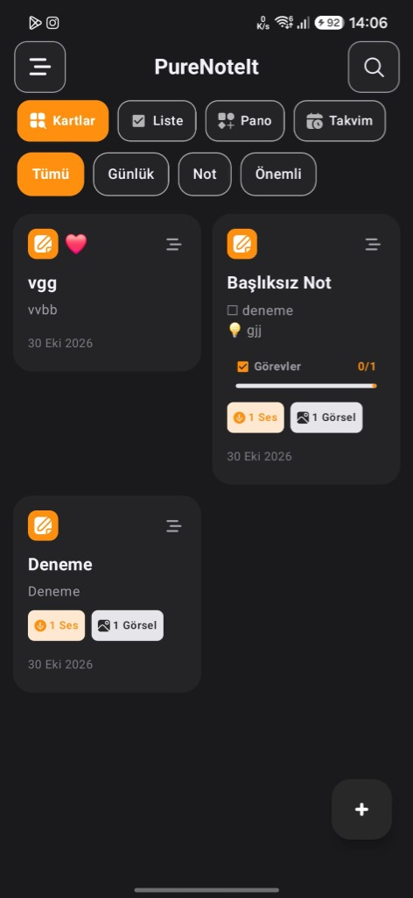
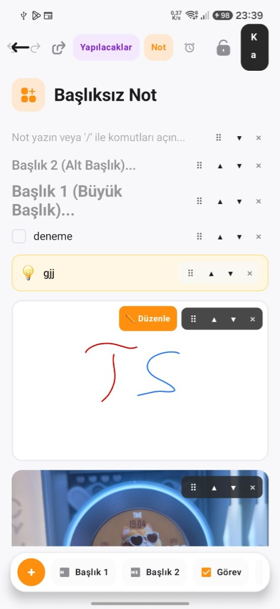
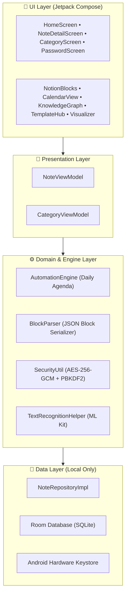

<div align="center">

  

  # PureNoteIt
  ### *Düşüncelerinizin En Saf Hali • The Purest Form of Your Thoughts*

  <p align="center">
    <b>Modern, Blok Tabanlı, Çevrimdışı ve Güvenlik Odaklı Android Kişisel Bilgi İşletim Sistemi (Knowledge OS)</b><br />
    <i>A modern, block-based, offline-first & Bitwarden-grade secure Android personal knowledge system.</i>
  </p>

  <p align="center">
    <a href="#-özellikler--key-features">Özellikler</a> •
    <a href="#-ekran-görüntüleri--screenshots">Ekran Görüntüleri</a> •
    <a href="#-teknoloji-yığını--tech-stack">Teknoloji</a> •
    <a href="#-kurulum--building">Kurulum</a> •
    <a href="PRIVACY_POLICY.md">Gizlilik Politikası</a> •
    <a href="LICENSE">Lisans</a>
  </p>

  <p align="center">
    
    
    
    
    
    
    
  </p>

</div>

---

## 📖 Genel Bakış / Overview

**PureNoteIt**, Notion'ın dinamik blok modülerliğini, Obsidian'ın çift yönlü bağlantı ve bilgi grafiğini (`[[Bağlantı]]`), Bitwarden'ın askeri standarttaki **AES-256-GCM** yerel şifrelemesini tek bir yerel (native) Android uygulamasında birleştiren yeni nesil bir not alma ve düşünce mimarisidir.

Buluta bağımlı olmayan **%100 Çevrimdışı (Offline-First)** mimarisi sayesinde verileriniz yalnızca sizin cihazınızda yaşar. Hiçbir sunucuya veri aktarılmaz, hiçbir kullanıcı takip edilmez, reklam içermez.

---

## 📱 Ekran Görüntüleri / Screenshots

<div align="center">
  <table>
    <tr>
      <td align="center" width="33%">
        <b>Aydınlık Tema Ana Ekran</b><br />
        <sub>Kategoriler, Filtreler & Not Kartları</sub><br /><br />
        
      </td>
      <td align="center" width="33%">
        <b>Koyu Tema & İlerleme Takibi</b><br />
        <sub>Staggered Grid & Medya Rozetleri</sub><br /><br />
        
      </td>
      <td align="center" width="33%">
        <b>Notion Blok Editörü</b><br />
        <sub>Başlıklar, Çizim, Checklist, Callout</sub><br /><br />
        
      </td>
    </tr>
    <tr>
      <td align="center" width="33%">
        <b>Aylık İnteraktif Takvim</b><br />
        <sub>Etkinlik Noktaları & Zaman Çizelgesi</sub><br /><br />
        
      </td>
      <td align="center" width="33%">
        <b>Haftalık Kolon Ajandası</b><br />
        <sub>Günlük Kolonlar & Hızlı Not Ekleme</sub><br /><br />
        
      </td>
      <td align="center" width="33%">
        <b>Zirve Özellikler</b><br />
        <sub>Şablon Galerisi, Kısayollar, OCR</sub><br /><br />
        <br />
        <sub>✨ 100% Offline & Bitwarden Vault</sub>
      </td>
    </tr>
  </table>
</div>

---

## ✨ Öne Çıkan Özellikler / Key Features

### 🧱 1. Notion Tarzı Dinamik Blok Editörü
- **Zengin Blok Çeşitleri:** Paragraf, Başlık 1 (H1), Başlık 2 (H2), Yapılacaklar (Checklist), Madde İşaretli Liste, Callout (Önemli Kutu), Açılır Kapanır **Toggle** (Spoiler gizleme), Dinamik **Tablolar** (otomatik dip toplam), Serbest El Çizim Kanvası, Fotoğraf ve Ses Dosyaları.
- **Hiyerarşik Alt Sayfalar (`Sub-pages`):** Notion tarzı alt sayfalar ana ekranda karmaşayı önlemek için gizlenir, doğrudan bağlı olduğu sayfadan veya global aramayla açılır.
- **Slash Menüsü (`/`):** İstediğiniz bloğu klavyeden tek tuşla ekleyin.

### 🔐 2. Bitwarden Seviyesinde Güvenlik & Kasa
- **Donanım Destekli AES-256-GCM Şifreleme:** Kilitli notlar cihazınızın yerel Keystore'u ile şifrelenir.
- **Biyometrik Kilit & PIN Doğrulama:** Parmak izi veya yüz tanıma ile anında güvenli erişim.
- **Arka Plana Geçince Otomatik Kilit (Vault Timeout):** Uygulamadan çıkıldığında veya başka bir uygulamaya geçildiğinde güvenlik oturumu sıfırlanır.
- **Yedekleme & Geri Yükleme:** Şifreli ve güvenli yerel JSON yedek dışa/içe aktarma merkezi.

### 📋 3. Şablon Galerisi (Templates Hub)
- Tek tıkla yüklenen 5 profesyonel hazır Notion şablonu:
  - 🤝 **Toplantı Notları:** Katılımcılar, gündem maddeleri, kararlar ve görev dağılımı.
  - 💰 **Aylık Bütçe Planı:** Dinamik tablo bloğu, gelir/gider kalemleri ve tasarruf özeti.
  - 📚 **Kitap & Medya İncelemesi:** Yıldız puanlama, ana temalar ve içine detay gizlenen Toggle bloğu.
  - ✈️ **Seyahat & Bavul:** Pasaport, bilet kontrolü ve kategorize bavul listesi.
  - 🎯 **Haftalık Hedefler & Sprint:** P1 ve P2 öncelikli sprint görevleri ve alışkanlık takipçisi.

### 🏷️ 4. Akıllı Hızlı Filtreleme Çipleri
- Ana ekranda anlık hibrit filtreleme:
  - `Tümü`, `Sabitlenenler`, `Kilitli`, `Hatırlatıcılar`, `Fotoğraflar`, `Ses Kayıtları`, `Görevler`, `Tablolar`.
- Hashtag Desteği (`#Etiket`): Notlarınızdaki tüm etiketleri otomatik derler ve yatay filtre barında listeler.

### 📅 5. İnteraktif Takvim & Kolon Planlayıcı
- **Aylık Takvim Görünümü:** Her günün altında o güne ait notları renkli etkinlik noktalarıyla gösterir.
- **Haftalık Kolon Görünümü:** Gün gün organize edilmiş sütunlarda sürükleyip bırakarak planlama imkanı.
- **Otomatik Günün Ajandası:** Her güne özel motivasyon mottosu ve 3 öncelikli görev içeren ajanda üretici.

### 🕸️ 6. 2D Bilgi Grafiği & Çift Yönlü Bağlantılar
- **Obsidian Tarzı Ağ Görünümü:** Notlar arasındaki bağlantıları (`[[Not Başlığı]]`) fizik tabanlı interaktif neon düğümlerle görselleştirin.
- **Geri Bağlantılar (Backlinks):** Bir nota hangi diğer notların referans verdiğini anında listeleyin.

### 🎙️ 7. Sesli Dikte & Spotify Tarzı Dalga Görselleştirici
- Google Konuşma Motoru ile canlı sesli dikte (sesi anında metin bloklarına dönüştürür).
- Dahili ses kayıt cihazı ve oynatıcı için gerçek zamanlı frekans dalgası (waveform) animasyonu.

### 📷 8. Google ML Kit On-Device Belge Tarama (OCR)
- Kamera veya galeriden fotoğraf seçerek metinleri %100 çevrimdışı ve yapay zeka destekli olarak anında bloklara aktarın.

### ⚡ 9. Android Uygulama İkonu Kısayolları (App Shortcuts)
- Uygulama ikonuna uzun basarak tek hamlede:
  - ➕ Yeni Not Oluştur
  - 🎙️ Sesli Dikte Başlat
  - 📷 Belge Tara / OCR
  - 📅 Günün Ajandasını Aç

### 📄 10. PDF Studio & Zen Okuma Modu
- **A4 PDF Dışa Aktarma:** Notları başlıkları, callout'ları, çizimleri ve tablolarıyla tertemiz birer PDF belgesine dönüştürün.
- **Zen Okuma Modu:** Dikkat dağıtıcı tüm arayüzü gizleyen, kelime sayısı ve okuma süresi hesaplayan minimalist okuma alanı.

### 🌐 11. %100 Çift Dilli Altyapı (Türkçe & English)
- Uygulama içi dil değiştirici (cihaz dilinden bağımsız olarak Türkçe veya İngilizce seçebilme).
- Tüm şablonlar, butonlar, diyaloglar ve hata mesajları her iki dilde de tam eşitliktedir.

---

## 🛠️ Mimari & Teknoloji Yığını / Architecture & Tech Stack

PureNoteIt, **Clean Architecture** prensipleri ve **Google Modern Android Development (MAD)** standartları ile geliştirilmiştir:



- **Programlama Dili:** [Kotlin 2.0](https://kotlinlang.org/)
- **Kullanıcı Arayüzü:** [Jetpack Compose](https://developer.android.com/jetpack/compose) & [Material Design 3](https://m3.material.io/)
- **Mimari:** MVVM + Clean Architecture + Repository Pattern
- **Bağımlılık Enjeksiyonu (DI):** [Dagger Hilt](https://dagger.dev/hilt/)
- **Veritabanı & Kalıcılık:** [Room SQLite Database](https://developer.android.com/training/data-storage/room)
- **Kriptografi & Güvenlik:** AES-256-GCM, Android Keystore, [AndroidX Biometric](https://developer.android.com/training/sign-in/biometric-auth)
- **Asenkron & Reaktif:** Kotlin Coroutines, StateFlow, RxJava3
- **Yapay Zeka & Görüntü İşleme:** [Google ML Kit Text Recognition](https://developers.google.com/ml-kit/vision/text-recognition/android) (On-Device)
- **Görsel Yükleme:** [Coil Compose](https://coil-kt.github.io/coil/)
- **PDF & Medya:** Android Native PdfDocument API, MediaRecorder & AudioTrack

---

## 🚀 Projeyi Derleme & Çalıştırma / Building from Source

### Gereksinimler
- **Android Studio:** Ladybug (2024.2+) veya daha yenisi
- **JDK:** Java 17 veya Java 21
- **Android SDK:** Compile SDK 35, Min SDK 26 (Android 8.0 Oreo ve üzeri)

### Adım Adım Kurulum

1. Depoyu yerel makinenize klonlayın:
   ```bash
   git clone https://github.com/omeryavuzyigit61/PureNoteIt.git
   cd PureNoteIt
   ```

2. Projeyi derleyin ve birim testlerini çalıştırın:
   ```bash
   # Linux / macOS
   ./gradlew testDebugUnitTest assembleDebug

   # Windows PowerShell
   .\gradlew.bat testDebugUnitTest assembleDebug
   ```

3. Çıktı APK dosyası:
   `app/build/outputs/apk/debug/app-debug.apk` dizininde oluşturulacaktır.

---

## 🔒 Güvenlik & Gizlilik Politikası / Security & Privacy

PureNoteIt, kullanıcı gizliliğini temel insan hakkı olarak kabul eder. Uygulama hiçbir kişisel verinizi toplamaz, satmaz veya harici sunuculara iletmez.

Detaylı ve Google Play uyumlu Gizlilik Politikası belgemiz için:
👉 **[PRIVACY_POLICY.md](PRIVACY_POLICY.md)** dosyasını inceleyebilirsiniz.

---

## 📜 Lisans & Telif Hakkı / License

Bu proje **MIT Lisansı** altında lisanslanmıştır. Kaynak kodunu inceleyebilir, geliştirebilir ve katkıda bulunabilirsiniz.

Ayrıntılar için **[LICENSE](LICENSE)** dosyasına bakınız.

Copyright © 2026 **Ömer Yavuz Yiğit**. Tüm hakları saklıdır.

---

<div align="center">
  <sub>Geliştirici: <b>Ömer Yavuz Yiğit</b> • İletişim: <a href="mailto:yavuzyigitomer52@gmail.com">yavuzyigitomer52@gmail.com</a></sub><br />
  <sub>PureNoteIt — <i>Thoughts, organized purely.</i></sub>
</div>
